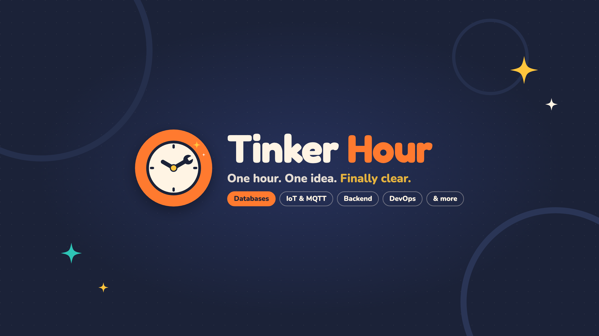

<p align="center">
  
</p>

<h3 align="center">One hour. One idea. Finally clear. 🔧⏰</h3>

<p align="center">
  <a href="https://www.youtube.com/@TinkerHour"></a>
  <a href="https://tinkerhour.com"></a>
  <a href="https://github.com/tinker-hour/code"></a>
</p>

---

**Tinker Hour** is a YouTube channel where hard tech finally clicks.
Each video takes **one idea** and works through it hands-on until it makes sense.

### 📺 Series

| Series | What you'll build | Code |
|---|---|---|
| 📡 **MQTT from Zero** | Brokers, pub/sub, QoS, ESP32 sensors, dashboards | [`mqtt-from-zero/`](https://github.com/tinker-hour/code/tree/main/mqtt-from-zero) |
| 🐘 **Postgres, Finally Clear** | Indexes, query plans, performance, real schemas | [`postgres-finally-clear/`](https://github.com/tinker-hour/code/tree/main/postgres-finally-clear) |
| 🐳 **Docker in an Hour** | Containers, Compose, deploying your stack | [`docker-in-an-hour/`](https://github.com/tinker-hour/code/tree/main/docker-in-an-hour) |
| ⚡ **Quick Tinkers** | Short one-off builds (FastAPI, scripts, tricks) | [`quick-tinkers/`](https://github.com/tinker-hour/code/tree/main/quick-tinkers) |

### 🛠️ How to use the code

```bash
git clone https://github.com/tinker-hour/code.git
cd code/<series>/<episode>
```

Every episode folder has its own README with the commands shown in the video.

📬 Say hello: **hello@tinkerhour.com**

<p align="center"><sub>Grab a coffee ☕. It's Tinker Hour.</sub></p>
